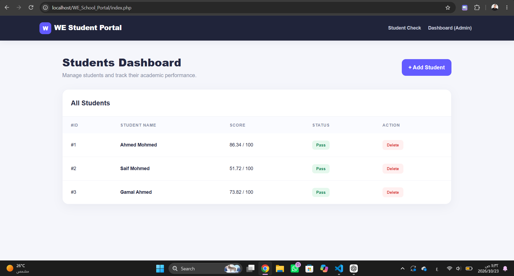
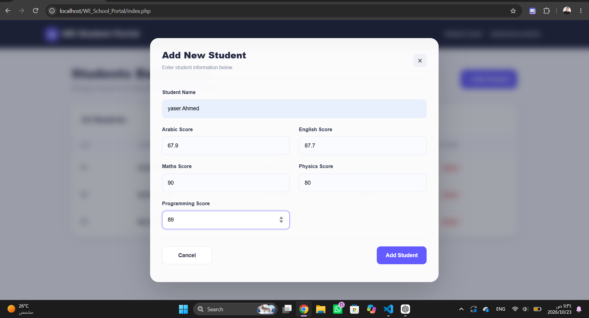
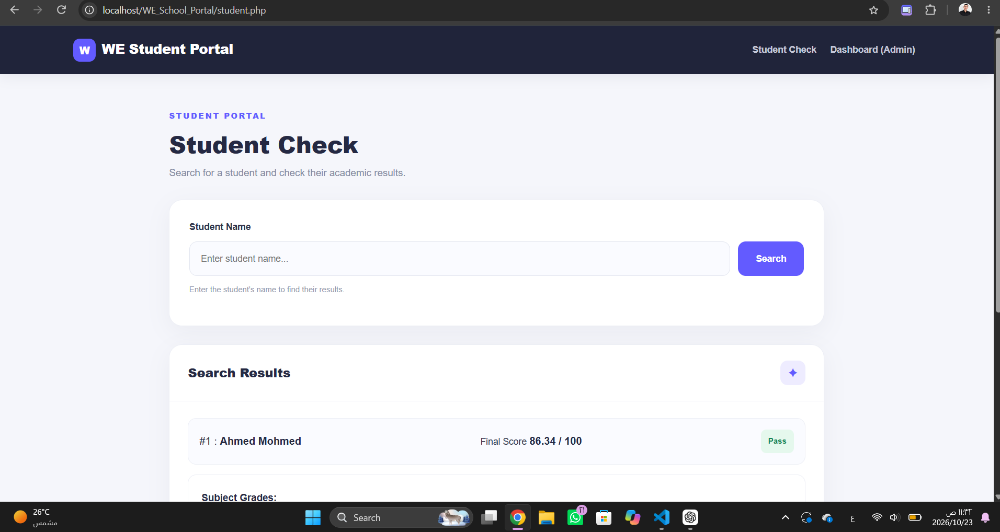

# 🎓 WE School Portal

**A Web-Based Student Management System**

A PHP and MySQL web application designed to manage student records, search student information, and track academic performance through a simple administrative dashboard.

---

## 📸 Screenshots

### Dashboard


### Add Student


### Student Records


> Replace the image paths above with the actual paths of your screenshots.

---

## ✨ Features

- **Student Management** — Add and manage student records.
- **Student Search** — Search for students by name.
- **Academic Performance** — Display student scores and passing/failing status.
- **Delete Records** — Remove student records from the database.
- **Input Validation** — Validate submitted data before processing.
- **Database Connectivity** — Connect PHP to MySQL using PDO.
- **Prepared Statements** — Use parameterized queries to help prevent SQL injection.
- **Reusable Components** — Separate database connection and navigation files.
- **Responsive Interface** — Build the user interface with Bootstrap.

---

## 🛠️ Tech Stack

| Technology | Purpose |
|---|---|
| HTML5 | Page structure |
| CSS3 | Custom styling |
| Bootstrap 5 | UI components and responsive layout |
| PHP | Backend development |
| MySQL | Relational database |
| PDO | Database connectivity and prepared statements |
| XAMPP | Local development environment |
| Git & GitHub | Version control |

---

## 🗂️ Project Structure

```text
WE_SchooL_Portal/
│
├── assets/
│   ├── dashboard.png
│   ├── add-student.png
│   └── student-records.png
│
├── Connect.php
├── Navbar.php
├── index.php
├── student.php
├── style.css
└── README.md
```

---

## 🗄️ Database

**Database Name:** `school_db`

**Main Table:** `students`

The database stores student information, including names and academic scores.

PDO (PHP Data Objects) is used to connect the application to the database and execute SQL queries. Prepared statements help separate SQL commands from user-supplied values, improving query security when used correctly.

---

## ⚙️ Installation & Setup

### Prerequisites

- XAMPP
- PHP with the PDO MySQL driver enabled
- MySQL or MariaDB
- A modern web browser

### 1. Clone the Repository

```bash
git clone https://github.com/hamzasherif565-rgb/WE_SchooL_Portal.git
```

### 2. Move the Project

Place the project folder inside XAMPP's `htdocs` directory:

```text
C:\xampp\htdocs\WE_SchooL_Portal
```

### 3. Start the Services

Open XAMPP Control Panel and start **Apache** and **MySQL**.

### 4. Create the Database

Open phpMyAdmin:

```text
http://localhost/phpmyadmin/
```

Create a database named `school_db` and create the `students` table with the columns required by the application.

### 5. Configure the Database Connection

Open `Connect.php` and configure the PDO connection using your local database settings.

Example:

```php
<?php
$Host = "localhost";
$DBName = "school_db";
$User = "root";
$Password = "";

try {
    $Connect = new PDO(
        "mysql:host=$Host;dbname=$DBName;charset=utf8mb4",
        $User,
        $Password
    );

    $Connect->setAttribute(
        PDO::ATTR_ERRMODE,
        PDO::ERRMODE_EXCEPTION
    );

} catch (PDOException $e) {
    die("Database connection failed.");
}
?>
```

> Use credentials appropriate for your environment. Avoid displaying database errors or sensitive connection details to end users in production.

### 6. Run the Application

Open the following URL in your browser:

```text
http://localhost/WE_SchooL_Portal/
```

---

## 🔐 Security Practices

- Use PDO prepared statements for queries involving user input.
- Validate submitted data on the server.
- Escape output appropriately to reduce cross-site scripting (XSS) risks.
- Apply appropriate database permissions.
- Add authentication and authorization before exposing administrative features publicly.

---

## 🎯 Learning Objectives

This project provides practical experience with:

- PHP fundamentals and server-side programming.
- CRUD operations and relational databases.
- PDO database connections and prepared statements.
- HTML form handling and input validation.
- Searching and filtering database records.
- Reusable PHP components.
- Git and GitHub workflows.

---

## 🚀 Future Improvements

- Update student records.
- Add administrator authentication and authorization.
- Improve dashboard statistics.
- Implement pagination and advanced filtering.
- Enhance error handling and application security.

---

## 👨‍💻 Developer

**Hamza Sherif**

Programming Student | Web Development

- **GitHub:** [@hamzasherif565-rgb](https://github.com/hamzasherif565-rgb)
- **Repository:** [WE_SchooL_Portal](https://github.com/hamzasherif565-rgb/WE_SchooL_Portal)

---

⭐ If you find this project interesting, consider giving it a star!

